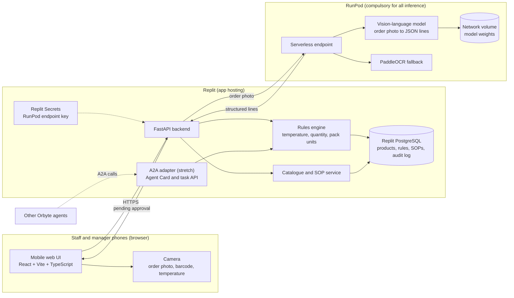

# 1st Proposal: Smart Receiving Check for F&B SMEs

**Challenge:** Orbyte Smart SME Challenge, Domain 2
**Deadline:** Sunday 25 Oct 2026, 08:00 MYT (submit by 06:00 as buffer)
**Status:** Proposal, for team approval

---

## 1. Problem

Small F&B outlets lose stock and money at the point of delivery:

- Frozen goods arrive outside their safe temperature range and are accepted anyway.
- Bundle and box quantities are counted wrongly (e.g. 250 pcs per bundle, 12 packets per box), so stock and orders drift apart.
- Staff are not trained on the correct receiving steps, and nobody records what happened.

These are recurring, daily losses, and they are invisible until stock runs out or food spoils.

## 2. Solution

One automated journey: **Receiving check**. Staff record each delivery in a phone-friendly web app. The system reads the delivery order, checks each line against product rules, sends any failures to a manager for approval, and logs the outcome.

AI reads and explains. Rules decide. Humans approve.

## 3. The journey

| Step | What happens | Who |
|---|---|---|
| **Trigger** | Staff tap "Receive delivery" | Staff |
| **Data** | Photo of delivery order is taken; scan or pick each product; enter probe temperature per line | Staff |
| **Extraction** | Model on RunPod reads the order and returns line items (item, quantity, pack unit) as JSON | AI (RunPod) |
| **Logic** | Rules engine checks temperature range, quantity vs. expected, and pack-to-base-unit conversion | Code (no AI) |
| **Approval** | Any failed check goes to a manager: accept, reject, or return, with a reason | Manager |
| **Logged outcome** | Audit record saved (who, when, readings, photo, decision); stock on hand updated | System |

Stretch goals, only if the core is done: (1) low-stock alert that drafts a reorder for manager approval; (2) an A2A endpoint that exposes the receiving check to other Orbyte agents.

## 4. Scope

**In (v1):**
- Product catalogue with categories (create, edit, delete)
- Per-product rules: temperature range, base unit, pack conversion, minimum threshold
- Receiving journey end to end, happy path and fail path
- Manager approval and audit log
- SOP cards per product, plus a simple SOP lookup for staff
- Seed data: 10 products including the examples from the brief (frozen sausage, chocolate balls, fries tray, hot dog box, nuggets, Coke)

**Out (roadmap):**
- Demand forecasting
- POS integration
- Multi-outlet support
- Real IoT thermometers
- Full SOP editor with version history
- Custom-trained object detection (YOLO)
- Google ADK agent orchestration (not needed for a fixed pipeline)

## 5. Tech stack

| Layer | Choice | Why |
|---|---|---|
| **Compute / AI inference** | **RunPod (compulsory)** | All model inference runs here. Serverless endpoint for the live app; a Pod for experiments. |
| **Model** | Open-weight vision-language model, served on RunPod. Shortlist: Qwen VL-family and Gemma multimodal variants (confirm vision support). Final pick made on Wed 21 Oct after testing 2 candidates on the test set in section 12. | Reads delivery-order photos into JSON. No training needed. |
| **Fallback OCR** | PaddleOCR, on the same RunPod endpoint | Used if the model misreads numbers on the order |
| **Other AI** | Allowed if it runs on RunPod. No external inference API is used in the core path. | Keeps the compliance story clean |
| **Agent framework** | None in v1. Google ADK is not used, because the journey is a fixed pipeline (extract, check, approve, log), not an agent loop. | Less setup, and no Gemini default to override |
| **Agent interop (stretch)** | A2A endpoint (Agent Card and task endpoint) that wraps the receiving check. Added on Saturday only if the core works. | Lets other Orbyte agents reuse the receiving check |
| **App hosting** | Replit (deployment) | Hosts the web app and API |
| **Backend** | Python, FastAPI | Same language as the RunPod worker, so one codebase for logic and model calls |
| **Frontend** | React + Vite + TypeScript, mobile-first. Vite builds static files that FastAPI serves. | TypeScript types the API responses, which catches frontend and backend mismatches early. React has the most examples for forms and camera UIs. |
| **Database** | Replit PostgreSQL (fall back to SQLite if the plan lacks it) | Stores catalogue, rules, SOPs, and audit log |
| **Barcode scan** | html5-qrcode in the browser | Uses the phone camera; no ML needed |
| **Secrets** | Replit Secrets | Holds the RunPod endpoint key; never committed to git |
| **Model weights** | RunPod network volume | Avoids re-downloading the model on every cold start |
| **Tests** | pytest for the rules engine and extraction parser, using sample delivery orders | Proves the logic, not just the UI |
| **Source control** | GitHub repo `SDCIdea26` | Team history and submission |

**Not used:** YOLO or any other custom-trained detector in v1. Training would need a labelled dataset we do not have, and the journey does not require detection. Google ADK is also not used in v1 (see the agent framework row above).

### 5.1 Architecture diagram

**Reading the diagram:** staff use the browser on their phones. The Replit backend holds all business logic and data. The only AI step runs on RunPod, and the backend calls it with the order photo and gets back structured lines. The rules engine, not the model, decides pass or fail. Manager approval happens in the same web UI. The A2A adapter is a stretch item that lets other Orbyte agents call the same rules engine.

## 6. Rules (deterministic, no AI)

- **Temperature:** reading must fall inside the product's range. Example: frozen sausage −20 °C to −10 °C; chocolate balls −10 °C to 0 °C. Outside the range = fail.
- **Quantity:** received quantity is converted to base units (e.g. 2 bundles × 250 pcs = 500 pcs) and compared with the expected quantity. Any difference = fail.
- **Missing data:** a missing temperature or unrecognised product = fail, so a human must check it.
- **Approval:** any fail blocks the delivery from being marked accepted until a manager decides.

## 7. Timeline (MYT)

| Day | Date | Goal | Done when |
|---|---|---|---|
| Tue | 20 Oct | Proposal written; scope agreed | This document approved by the team |
| Wed | 21 Oct | Accounts and data. Replit project created. React + Vite + TypeScript scaffold set up. RunPod account and endpoint created. Two models tested on the test set (section 12). Product list and pack conversions confirmed with the team. | Model chosen; seed data ready |
| Thu | 22 Oct | Catalogue CRUD and database schema. RunPod endpoint serving the chosen model. Extraction returns valid JSON for the 5 samples. | Catalogue works; extraction works from Replit |
| Fri | 23 Oct | Receiving journey, happy path and fail path. Rules engine with tests. Temperature and quantity checks working. | A delivery can be recorded and checked end to end |
| Sat | 24 Oct | Manager approval, audit log, stock update. SOP cards and lookup. Demo data loaded. Feature freeze at 22:00. | Full journey runs on the demo phone |
| Sun | 25 Oct | Rehearse demo. Submission pack: slides, 2-minute video, README, RunPod endpoint link. Submit by 06:00. | Submitted before 08:00 |

**Rule:** after Sat 22:00 no new features. Only bug fixes and submission material.

## 8. Business benefit

Pick one metric and measure it in the demo, using stated assumptions only:

- Minutes per delivery saved (manual counting vs. photo + confirm)
- Number of out-of-range deliveries caught before acceptance
- Estimated spoiled stock avoided per month (state the assumption explicitly)

Do not quote statistics we cannot source.

## 9. SDG link

- **SDG 12.3 (primary):** reduce food waste and losses along supply chains. Catching bad deliveries at receiving stops spoiled stock entering the kitchen.
- **SDG 8 (secondary):** SOP cards and the lookup help new staff learn correct handling quickly.

## 10. Orbyte fit

The Orbyte platform details are not yet confirmed. Before Wed 21 Oct, the team should check which Orbyte modules and APIs are available (for example login, inventory, approvals). Reuse them rather than rebuilding, and name them in the pitch. Until then, the design keeps those parts behind a thin interface so they can be swapped in.

## 11. Risks and mitigations

| Risk | Mitigation |
|---|---|
| Scope creep | Scope fixed in section 4; feature freeze Sat 22:00 |
| Model misreads the delivery order | Staff confirm every extracted line before it is saved; OCR fallback |
| RunPod cold start makes the demo slow | Keep the endpoint warm for the demo; pre-run one request before judging |
| RunPod cost | $25 budget in section 13; stop endpoints after each test run; use scale-to-zero; delete unused endpoints |
| Orbyte modules unclear | Check on Wed; fall back to standalone auth and catalogue |
| Rules change between teammates | Rules live in the database as data, with unit tests as the source of truth |

## 12. Data plan

We do not train a model in v1. The data is used to test the candidates and to show judges how they were chosen.

| Data | Source | Used for | Notes |
|---|---|---|---|
| Receipt and invoice images | Kaggle: [OCR Receipts Text Detection](https://www.kaggle.com/datasets/trainingdatapro/ocr-receipts-text-detection), [CORD_1000](https://www.kaggle.com/datasets/lonelvino/cord-1000), [Expenses Receipt OCR](https://www.kaggle.com/datasets/sushmithanarayan/expenses-receipt-ocr) | Warm-up and extraction tests | Evaluation only. Check each license. The retail set asks you to contact the publisher before commercial use. |
| Mock delivery orders | Team-made, 10 to 20 orders | Main test set for both candidates | Label the true lines by hand. Include blur, skew, and handwriting. Mark as test data. |
| Product rules and pack conversions | Team, from the store | Seed data and rules | Settle the Coke conversion first. |
| Shelf images | Kaggle: [Supermarket Shelves Dataset](https://www.kaggle.com/datasets/humansintheloop/supermarket-shelves-dataset) | Only if product counting is added | Not in v1. |

**Test protocol (proposed thresholds):**
- Valid JSON on at least 95% of test orders
- Item, quantity, and unit exactly right on at least 90% of lines
- Latency and cost per order recorded for each candidate

**Decision rule:** pick the candidate that meets the thresholds at the lower cost per order. If neither does after prompt tuning, the app still works: staff type the lines, and the rules and approval flow run as normal. A small fine-tune is a contingency only, and it needs labelled data kept separate from the test set.

## 13. Budget (USD 25)

Assumption: a 24 GB serverless worker costs about $0.69 per hour. That is a 2024 published rate, so confirm it on RunPod's live pricing page. At that rate, $25 buys about 36 GPU hours.

| Item | GPU hours | Cost | When |
|---|---|---|---|
| Candidate A test run | 1 | $0.69 | Wed 21 Oct |
| Candidate B test run | 1 | $0.69 | Wed 21 Oct |
| Test set evaluation, both models | 2 | $1.38 | Wed to Thu |
| Development and debugging endpoint | 8 | $5.52 | Thu to Fri |
| Demo warm-up and rehearsal | 2 | $1.38 | Sat to Sun |
| Contingency: small fine-tune, only if both candidates fail | 2 | $1.38 | Sat, if needed |
| **Planned total** | **16** | **$11.04** | |
| **Unspent reserve** | | **$13.96** | |

**Cost rules:**
- Use serverless with scale-to-zero, one worker at most, and a short idle timeout.
- Stop or delete each endpoint after its test run.
- Never leave a Pod running overnight.
- Check whether the network volume for model weights is billed separately, and count it in the budget.
- Set a spend alert in RunPod if the account allows it.

## 14. Open items for the team

1. Confirm the hackathon rules on other AI models (proposal assumes any model is allowed if it runs on RunPod).
2. Confirm the Orbyte modules and APIs available to us.
3. Confirm the pack conversion for Coke. The brief says "8 oz (4.5 kg) / box", which mixes units, so the team must agree on the base unit before seeding data.
4. Assign owners: backend, frontend, RunPod/model, demo and submission.
5. Confirm the RunPod price on the live pricing page, and approve the budget split in section 13.
6. Check the license of each Kaggle dataset before use.
