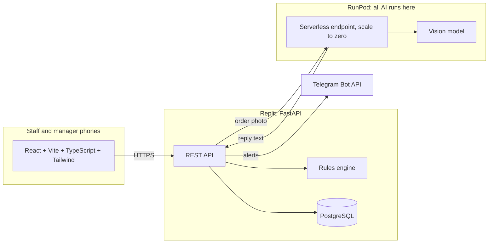

# SopBox: Smart Receiving Check for F&B SMEs

Orbyte Smart SME Challenge, Domain 2. Staff photograph a delivery order, the system checks every line against product rules, a manager approves any exception, and every outcome is logged.

It is a real multi-user app, not a demo: anyone can create a workspace and becomes its owner, and the owner creates accounts for their managers and staff. A new workspace starts empty.

**AI reads. Rules decide. Humans approve.**

Full plan, timeline, budget and owners: [`1st_proposal.md`](1st_proposal.md).

## The problem

Small F&B outlets lose stock and money at the point of delivery:

- Frozen goods arrive outside their safe temperature range and are accepted anyway.
- Bundle and box quantities are miscounted (250 pcs per bundle, 12 packets per box), so stock and orders drift apart.
- New staff are not trained on receiving steps, and nobody records what happened.

## Accounts and roles

| Role | Can do |
|---|---|
| **Owner** | Everything. The person who creates a workspace. Creates, disables and resets accounts, sets the Telegram chats |
| **Manager** | Edits categories and products (the rules), approves or rejects failed deliveries, reads the activity log |
| **Staff** | Receives deliveries, reads products and SOPs, reads delivery records |

Sign-in uses a username and password. Passwords are hashed with scrypt, sessions are random tokens in an HttpOnly cookie, and five wrong passwords lock an account for 15 minutes. Each workspace's data is separate: every query is scoped to the signed-in workspace, and PostgreSQL Row Level Security enforces the same rule inside the database. Names in the audit log come from the signed-in account, not from anything typed.

## What v1 does

One automated journey, with a person in control at the decision point.

| Step | What happens | Who |
|---|---|---|
| Trigger | Staff open **Receiving check** and photograph the delivery order | Staff |
| Data | A model on RunPod reads the lines. Anything it cannot read is left blank and flagged, never guessed. Staff confirm each line and enter a probe temperature | AI, then staff |
| Logic | Rules check temperature range, pack-to-base-unit conversion and ordered quantity | Code, no AI |
| Approval | Any failed line holds the whole delivery. A manager accepts, rejects or returns it, with a reason | Manager |
| Notify | Telegram alerts the manager when approval is needed, and staff with the decision (chats set per workspace) | Telegram bot |
| Logged outcome | Every step is written to the audit log. Accepting a delivery updates stock on hand | System |

Around the journey:

- A product catalogue with categories, a temperature range per category that a product can override, pack sizes, minimum stock thresholds, and an SOP card per product with search. Products on past deliveries are archived rather than deleted.
- **Import from a supplier sheet:** photograph a product list or SOP sheet, the model suggests products, and a manager corrects and ticks them before they are added.
- **Purchase orders (quantity only):** suppliers, draft, issue, cancel and print orders, and draft one from low stock. A delivery received against an issued order is checked against what is still outstanding on it; a product not on the order goes to a manager.

**SDG link:** 12.3 (less food waste: bad deliveries are stopped at the door) and 8 (SOP cards help new staff learn correct handling).

## Architecture



The backend treats the model's reply as untrusted input: it parses and validates it, and staff confirm every line before anything is saved.

## Status

| Part | Choice | Status |
|---|---|---|
| Inference | RunPod serverless, 24 GB GPU, scale to zero | Worker is a stub. Endpoint not created yet |
| Model | Open-weight vision model (PaddleOCR-VL vs Qwen3-VL) | Chosen on Wed 21 Oct from scores on mock orders |
| Backend | Python, FastAPI, pytest | Built and tested |
| Database | Replit PostgreSQL, with Row Level Security per workspace | Built and tested |
| Accounts | Workspace sign-up, owner, manager and staff roles | Built and tested |
| Frontend | React, Vite, TypeScript, Tailwind, Orbyte-style shell | Sign-in, dashboard, receiving, records, products and SOPs, approvals, activity, team, settings. Checked in a headless browser, not on a real phone |
| Notifications | Telegram Bot API | Alerts built. Owner pastes the chat ids in Settings. No bot-side linking |
| Agent | Google ADK extraction agent | Planned. Go/no-go Thu 22 Oct, else direct call |
| Barcode scan | html5-qrcode | Not built. Products are picked from a list |
| A2A endpoint | Lets other Orbyte agents call the check | Stretch, not built |
| Fine-tuning | LoRA on RunPod | Only if zero-shot misses the thresholds |

## Repository layout

```
src/backend/       FastAPI app: accounts, rules, catalogue, deliveries, extraction client, Telegram alerts
src/frontend/      React app (Vite). `npm run build` writes src/frontend/dist, which FastAPI serves
runpod/           RunPod endpoint settings and how to swap in fine-tuned weights
tests/             pytest suite for accounts, workspace isolation, the rules, API, extraction parsing and alerts
.replit            Replit run and deploy settings
submission/        Submission pack (slides, video, links), added at the end
1st_proposal.md    Plan, timeline, budget and owners
```

## Run it locally

You need Python 3.11 or newer and Node 20 or newer. The database is PostgreSQL. Without installing it, `requirements-dev.txt` includes an embedded one.

```bash
# Terminal 1: a local PostgreSQL. Prints two export lines; copy them into terminal 2.
cd src/backend
python3 -m venv .venv && . .venv/bin/activate
pip install -r requirements-dev.txt
python -m app.devdb

# Terminal 2: backend on http://localhost:8000
cd src/backend && . .venv/bin/activate
export DATABASE_URL=...  COOKIE_SECURE=0     # the lines from terminal 1
uvicorn app.main:app --reload --port 8000

# Terminal 3: frontend on http://localhost:5173 (proxies /api to :8000)
cd src/frontend
npm install
npm run dev
```

Open http://localhost:5173 and choose **Create a workspace**. You become the owner of an empty workspace. Add categories and products under **Products & SOP**, then create staff accounts under **Team**.

Reading photos needs a RunPod endpoint (see Configuration). Until then, staff type the lines by hand.

To run as one process, as on Replit: `npm run build` in `src/frontend`, then start uvicorn. It serves the built app and the API on port 8000.

## Deploy on Replit

Replit is mandatory for the challenge. The deployed filesystem is not persistent, which is why the database is PostgreSQL and not a file.

**Accounts and settings you need**

1. **Replit account on a plan that includes Deployments.** Check the current plan and credit rules on replit.com/pricing. Deployments are billed from your plan's credits.
2. **GitHub access for Replit.** Create a Repl by importing `Dellrall/SDCIdea26` from GitHub. Pick the branch you want to deploy. A private repository needs you to grant Replit access.
3. **A Replit PostgreSQL database.** In the Repl, open Tools, then Database, and create a PostgreSQL database. Replit sets `DATABASE_URL`. Confirm the deployment has it too (Deployments, Secrets).
4. **Secrets** (Tools, Secrets, and again on the deployment):

| Secret | Required | Value |
|---|---|---|
| `DATABASE_URL` | Yes | Set by the Replit database. Do not copy it into the repo |
| `RUNPOD_ENDPOINT_ID`, `RUNPOD_API_KEY` | For photo reading | The endpoint id (for example `sriet0cftztbik`) and an API key from your RunPod account (see `runpod/README.md`). Without them staff type lines by hand |
| `TELEGRAM_BOT_TOKEN` | For alerts | From @BotFather in Telegram |

   Leave `COOKIE_SECURE` unset on Replit: the app then sends the session cookie over HTTPS only.
5. **Deploy.** The `.replit` file builds the frontend and starts the app on port 8000 (Autoscale). Open the deployment URL and choose **Create a workspace**: that first account is the owner.

`.replit` has not been run on a live Replit deployment yet. If the build fails, the likely fixes are the Python or Node module versions and the `pip install` step.

## Configuration

The backend reads environment variables (Replit Secrets in production). See `src/backend/.env.example`.

| Variable | Purpose | Default |
|---|---|---|
| `DATABASE_URL` | PostgreSQL connection string. Required | none |
| `COOKIE_SECURE` | `0` allows the session cookie over plain http, for local runs only | `1` |
| `RUNPOD_ENDPOINT_ID`, `RUNPOD_API_KEY` | RunPod endpoint id and API key. Without both, photo reading is off | none |
| `TELEGRAM_BOT_TOKEN` | Bot token. Each workspace owner sets chat ids under Settings. With no token or chat id, alerts are skipped | none |

Never commit keys. `.env` is git-ignored.

## API

Every route except `/api/health` and the two sign-in routes needs a signed-in session. Roles are checked on the server.

| Route | Who | Purpose |
|---|---|---|
| `POST /api/auth/register` | anyone | Create a workspace and its owner (email required), and sign in |
| `POST /api/auth/login` | anyone | Sign in with a username or an email |
| `GET /api/auth/session` | anyone | Who is signed in, or `null` |
| `POST /api/auth/logout`, `GET /api/auth/me`, `PATCH /api/auth/me`, `POST /api/auth/password` | any signed in | Sign out, who am I, change my name or email, change my password |
| `GET /`, `GET /signin`, `GET /register` | anyone | The app. Signed out, `/` is the welcome page with a walkthrough of one delivery |
| `GET /robots.txt`, `GET /sitemap.xml` | anyone | For search engines. The page itself gets absolute canonical and link-preview URLs from the request's address |
| `GET/POST /api/users`, `PATCH /api/users/{id}` | owner | List, create, and change accounts (role, disable, reset password) |
| `GET/PATCH /api/workspace` | owner | Workspace name and Telegram chat ids |
| `GET /api/products?q=` | any | Products with stock. `q` searches name, category and SOP text |
| `POST /api/products`, `PUT/DELETE /api/products/{id}` | manager | Edit products |
| `PATCH /api/products/{id}` | manager | Archive or restore a product (`{"archived": true}`) |
| `POST /api/products/read-sheet`, `POST /api/products/bulk` | manager | Suggest products from a sheet photo (saves nothing); add reviewed products together, all or none |
| `GET /api/categories`; `POST`, `PUT/DELETE /api/categories/{id}` | any; manager | Categories and their default temperature range |
| `POST /api/extract` | any | Read an order photo into lines, matched to products |
| `POST /api/deliveries` | any | Check a delivery. Passing lines are stocked. Any failure holds it for a manager. With `purchase_order_id`, lines are checked against that issued order |
| `GET /api/suppliers`; `POST`, `PUT/PATCH /api/suppliers/{id}` | any; manager | Suppliers; `PATCH` archives or restores |
| `GET /api/purchase-orders?status=`, `GET /api/purchase-orders/{id}` | any | Orders with ordered, received, pending and outstanding quantities per line |
| `POST /api/purchase-orders`, `PUT /api/purchase-orders/{id}` | manager | Create or edit a draft |
| `POST /api/purchase-orders/{id}/issue`, `.../cancel`, `POST /api/purchase-orders/low-stock-draft` | manager | Issue, cancel (only with no deliveries), or draft from low stock |
| `GET /api/deliveries?status=`, `GET /api/deliveries/{id}` | any | Read deliveries |
| `POST /api/deliveries/{id}/decision` | manager | Accept, reject or return a held delivery |
| `GET /api/audit` | manager | Audit log, newest first |

"manager" includes the owner. The API docs page is switched off because its script loads from a CDN, which the strict Content-Security-Policy blocks.

## Tests

```bash
pip install -r src/backend/requirements-dev.txt
python -m pytest          # from the repository root
```

The suite starts an embedded PostgreSQL, so it needs no install, network, GPU or Telegram account. The app connects as an ordinary database role, so Row Level Security applies to every test. It covers sign-up, sign-in, roles, workspace isolation (including a direct database check), the rules, catalogue and delivery flows, decisions that cannot be made twice, the model-reply parser, the hourly cap on model calls, alerts that never break a delivery, and the security headers.

## Known limits

- The first photo after the endpoint has been idle waits for a cold start (a few minutes). Staff can type the lines instead.
- Anyone can create a workspace. An address can create 10 an hour. Accounts store an email and can sign in with it, but the app sends no email yet, so a forgotten owner password cannot be reset by the app: it takes a database change.
- The sign-in lockout counter is in memory, so it is per server process.
- The order photo is not stored. The audit log records readings and decisions, not the image.
- `.replit` is untested on a live deployment. If Replit's database role bypasses Row Level Security, the application-level workspace filters still apply.
- Manual stock corrections, barcode scanning and event-based SOPs (peak hour, new starter) are not built.

## Roadmap

From the original SopBox pitch, outside v1: a daily task list per role, a rotating person of the day, and a chat assistant that answers SOP questions. Also demand forecasting, POS integration and multi-outlet support.

## License

See [LICENSE](LICENSE).
