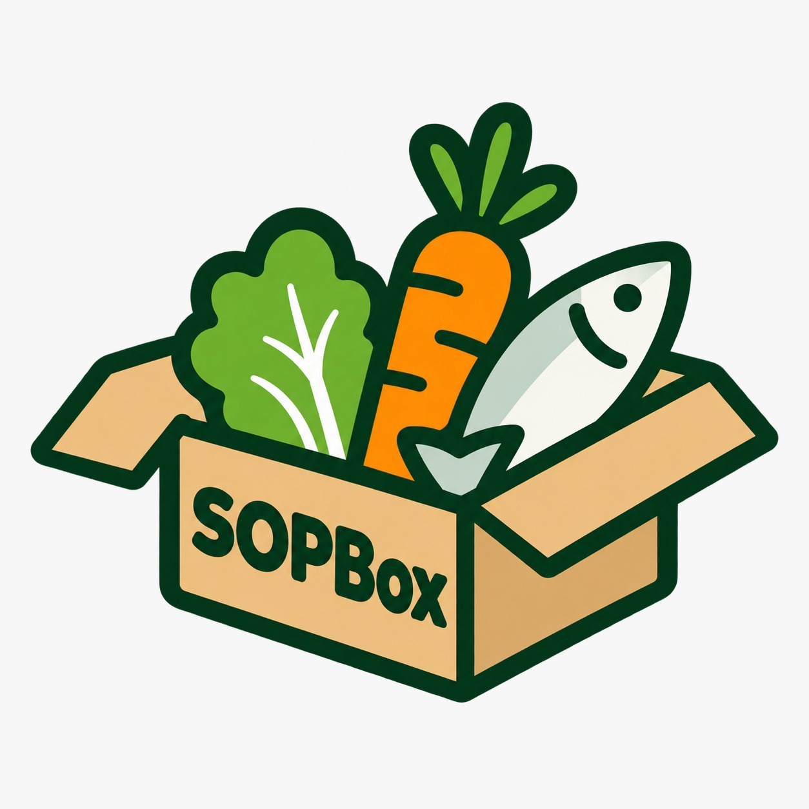
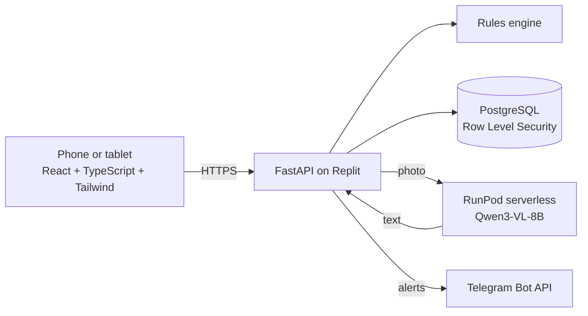

<p align="center">
  
</p>

<h1 align="center">SOPBox</h1>

<p align="center">
  <b>Smart receiving checks for small F&amp;B outlets.</b><br>
  AI reads. Rules decide. Humans approve.
</p>

<p align="center">
  <a href="https://sopbox.replit.app"><b>Live app: sopbox.replit.app</b></a>
  &nbsp;·&nbsp; Orbyte Smart SME Challenge, Domain 2
  &nbsp;·&nbsp; SDG 12.3 and SDG 8
</p>

---

## The problem

Small F&B outlets lose stock and money at the back door, when deliveries arrive:

- Frozen and chilled goods arrive outside their safe temperature and are accepted anyway.
- Pack quantities are miscounted (250 pcs per bundle, 12 packets per box), so stock and orders drift apart.
- New staff don't know the receiving steps, and nobody records what happened.

## Our solution

SOPBox turns receiving into one guided check on a phone, with a manager in control of every exception.

| Step | What happens | Who |
|---|---|---|
| 1. Photograph | Staff take or choose a photo of the delivery order | Staff |
| 2. Read | An AI vision model reads every line. Anything unclear is flagged, never guessed. Staff confirm each line and enter the probe temperature | AI, then staff |
| 3. Check | Rules check the temperature range, pack-to-unit conversion and the quantity still due on the purchase order | Code, no AI |
| 4. Approve | Any failed line holds the delivery. A manager accepts, rejects or returns it, with a reason | Manager |
| 5. Notify | The manager is told in the app inbox and on Telegram; staff hear the decision | App and Telegram |
| 6. Record | Every step is in the activity log. Accepted goods update stock on hand | System |

## Key features

- **Receiving check** with photo reading, probe temperatures, stock photos and teammate tagging.
- **Products & SOP cards:** per-product temperature ranges, pack sizes and step-by-step SOPs, with search. An **AI SOP writer** drafts steps from a manager's notes and a second pass checks them.
- **Import from a supplier sheet:** photograph a product or SOP sheet; the AI suggests products for a manager to correct and add.
- **Purchase orders** (quantity only), including a draft from low stock; deliveries are checked against what is still outstanding.
- **Approvals, delivery records, activity log and stock counts**, with an Excel template and import.
- **Team and roles:** owner, manager and staff, each seeing only what their role needs.
- **Sign-in options:** password, passkey, Google, Telegram, and a PIN on a shared kitchen tablet.
- **Telegram team group** that only the workspace's own active staff can join.
- **Built for phones:** every page is tested at 320px and 360px wide.

## How the AI is used

- **Model:** [Qwen3-VL-8B-Instruct](https://huggingface.co/Qwen/Qwen3-VL-8B-Instruct) (FP8), an open-weight vision-language model, used as released (not trained on our data).
- **Where it runs:** a RunPod serverless GPU endpoint that scales to zero, so it costs nothing when idle.
- **What it does:** reads delivery orders and supplier sheets, and drafts and checks SOPs.
- **Guard rails:** the reply is treated as untrusted input. It is parsed and validated, and staff confirm every line before anything is saved. The pass/fail decision is made by rules in code, not by the AI. An hourly cap on AI calls keeps GPU spend bounded.
- **Next:** a light LoRA fine-tune on synthetic delivery orders, swapped in behind the same endpoint name so the app is unchanged.

## Architecture



Each workspace's data is isolated twice: every query is scoped to the signed-in workspace, and PostgreSQL Row Level Security enforces the same rule inside the database. Passwords are hashed with scrypt, and sessions use HttpOnly cookies.

## Impact (SDGs)

- **SDG 12.3, less food waste:** unsafe deliveries are stopped at the door instead of being thrown away later.
- **SDG 8, decent work:** SOP cards and guided checks help new staff learn correct handling from day one.

## Try it

1. Open **https://sopbox.replit.app** and choose **Create a workspace**. You become its owner.
2. Add categories and products under **Products & SOP** (or import them from a sheet photo).
3. Add staff under **Team**, then run a **Receiving check**.

Photo reading needs the RunPod endpoint switched on. When it's off, staff type the lines by hand and everything else works.

## Run it locally

```bash
# Backend (an embedded PostgreSQL is included for local use)
cd src/backend && python3 -m venv .venv && . .venv/bin/activate
pip install -r requirements-dev.txt
python -m app.devdb            # prints DATABASE_URL; export it in a second terminal
uvicorn app.main:app --port 8000

# Frontend
cd src/frontend && npm install && npm run dev   # http://localhost:5173
```

Deployment, configuration, the API and test details are in [docs/DEVELOPMENT.md](docs/DEVELOPMENT.md).

## Testing

- **305 backend tests** (pytest) covering roles, workspace isolation, the rules, deliveries, AI reply parsing and security headers.
- **28 phone UI tests** (Playwright) that open every page as owner, manager and staff on 320px and 360px screens.
- Both run on every pull request in GitHub Actions.

## Built with

**Our own work:** the app, rules, AI prompts, tests and design.

**Third-party open source:** FastAPI, Uvicorn, Pydantic, httpx, psycopg, openpyxl, py_webauthn, React, Vite, TypeScript, Tailwind CSS, Lucide icons, SimpleWebAuthn, Plus Jakarta Sans (via Fontsource), pytest, Playwright; AI served with vLLM on RunPod's worker-v1-vllm image.

**Pre-trained model:** Qwen3-VL-8B-Instruct by the Qwen team (Apache 2.0).

**Services:** Replit (hosting and PostgreSQL), RunPod (GPU), Telegram Bot API, Google Sign-In.

**Images:** dashboard kitchen photo by Yanhao Fang on Unsplash; SDG icons © United Nations.

## License

Apache 2.0. See [LICENSE](LICENSE).
