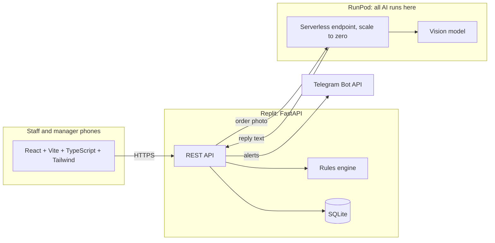

# SopBox: Smart Receiving Check for F&B SMEs

Orbyte Smart SME Challenge, Domain 2. Staff photograph a delivery order, the system checks every line against product rules, a manager approves any exception, and every outcome is logged.

**AI reads. Rules decide. Humans approve.**

Full plan, timeline, budget and owners: [`1st_proposal.md`](1st_proposal.md).

## The problem

Small F&B outlets lose stock and money at the point of delivery:

- Frozen goods arrive outside their safe temperature range and are accepted anyway.
- Bundle and box quantities are miscounted (250 pcs per bundle, 12 packets per box), so stock and orders drift apart.
- New staff are not trained on receiving steps, and nobody records what happened.

## What v1 does

One automated journey, with a person in control at the decision point.

| Step | What happens | Who |
|---|---|---|
| Trigger | Staff open **Receive** and photograph the delivery order | Staff |
| Data | A model on RunPod reads the lines. Staff confirm each line and enter a probe temperature | AI, then staff |
| Logic | Rules check temperature range, pack-to-base-unit conversion and ordered quantity | Code, no AI |
| Approval | Any failed line holds the whole delivery. A manager accepts, rejects or returns it, with a reason | Manager |
| Notify | Telegram alerts the manager when approval is needed, and staff with the decision | Telegram bot |
| Logged outcome | Every step is written to the audit log. Accepting a delivery updates stock on hand | System |

Around the journey: a product catalogue with categories (create, edit, delete), a temperature range per category that a product can override, pack sizes, minimum stock thresholds, and an SOP card per product with search.

**SDG link:** 12.3 (less food waste: bad deliveries are stopped at the door) and 8 (SOP cards help new staff learn correct handling).

## Architecture



The backend treats the model's reply as untrusted input: it parses and validates it, and staff confirm every line before anything is saved.

## Status

| Part | Choice | Status |
|---|---|---|
| Inference | RunPod serverless, 24 GB GPU, scale to zero | Worker is a stub. Endpoint not created yet |
| Model | Open-weight vision model (PaddleOCR-VL vs Qwen3-VL) | Chosen on Wed 21 Oct from scores on mock orders |
| Backend | Python, FastAPI, pytest | Built and tested |
| Database | SQLite now, Replit PostgreSQL if the plan allows | SQLite built |
| Frontend | React, Vite, TypeScript, Tailwind | Receive, Approvals and Catalogue screens built |
| Notifications | Telegram Bot API | Alerts built. Account linking not built |
| Agent | Google ADK extraction agent | Planned. Go/no-go Thu 22 Oct, else direct call |
| Barcode scan | html5-qrcode | Not built. Products are picked from a list |
| A2A endpoint | Lets other Orbyte agents call the check | Stretch, not built |
| Fine-tuning | LoRA on RunPod | Only if zero-shot misses the thresholds |

## Repository layout

```
src/backend/       FastAPI app: rules, catalogue, deliveries, extraction client, Telegram alerts
src/frontend/      React app (Vite). `npm run build` writes src/frontend/dist, which FastAPI serves
runpod/worker/     RunPod serverless handler and Dockerfile. See runpod/README.md
tests/             pytest suite for the rules, API, extraction parsing, alerts, seed data and worker
submission/        Submission pack (slides, video, links), added at the end
1st_proposal.md    Plan, timeline, budget and owners
```

## Run it locally

You need Python 3.11 or newer and Node 20 or newer.

```bash
# Terminal 1: backend on http://localhost:8000
cd src/backend
python3 -m venv .venv && . .venv/bin/activate
pip install -r requirements.txt
MANAGER_PIN=changeme uvicorn app.main:app --reload --port 8000

# Terminal 2: frontend on http://localhost:5173 (proxies /api to :8000)
cd src/frontend
npm install
npm run dev
```

Open http://localhost:5173. The first start loads a demo catalogue of ten products. Reading photos returns two fixed example lines until a RunPod endpoint is configured (`EXTRACTION_MODE=mock`).

To run as one process, as on Replit: `npm run build` in `src/frontend`, then start uvicorn. It serves the built app and the API on port 8000.

Managers need the PIN to approve deliveries or edit the catalogue. Enter it on the **Approvals** tab.

## Configuration

The backend reads environment variables (Replit Secrets in production). See `src/backend/.env.example`.

| Variable | Purpose | Default |
|---|---|---|
| `MANAGER_PIN` | Shared PIN for approvals and catalogue edits. Those routes return 503 if it is empty | none |
| `EXTRACTION_MODE` | `mock` or `runpod` | `mock` |
| `RUNPOD_ENDPOINT_URL`, `RUNPOD_API_KEY` | RunPod `runsync` URL and key, used when mode is `runpod` | none |
| `TELEGRAM_BOT_TOKEN` | Bot token. With no token or chat id, alerts are skipped | none |
| `TELEGRAM_MANAGER_CHAT_ID`, `TELEGRAM_STAFF_CHAT_ID` | Chats that get approval requests and decisions | none |
| `DB_PATH` | SQLite file | `src/backend/receiving.db` |

Never commit keys. `.env` is git-ignored.

## API

Reads are open. Rows marked *manager* need the `X-Manager-Pin` header. Interactive docs are at `/docs` when the backend runs.

| Route | Purpose |
|---|---|
| `GET /api/products?q=` | Products with stock. `q` searches name, category and SOP text |
| `POST /api/products`, `PUT/DELETE /api/products/{id}` | Edit the catalogue (*manager*) |
| `GET /api/categories`, `POST /api/categories`, `PUT/DELETE /api/categories/{id}` | Categories and their default temperature range (writes *manager*) |
| `POST /api/extract` | Read an order photo into lines, matched to products |
| `POST /api/deliveries` | Check a delivery. Passing lines are stocked. Any failure holds it for a manager |
| `GET /api/deliveries?status=`, `GET /api/deliveries/{id}` | Read deliveries |
| `POST /api/deliveries/{id}/decision` | Accept, reject or return a held delivery (*manager*) |
| `GET /api/audit` | Audit log, newest first |

## Tests

```bash
pip install -r src/backend/requirements.txt
python -m pytest          # from the repository root
```

The suite runs with no network, GPU or Telegram account. It covers the rules (including range limits), catalogue and delivery flows, manager-only access, decisions that cannot be made twice, the model-reply parser, the hourly cap on model calls, alerts that never break a delivery, and the seed data against the brief.

## Seed data

The demo catalogue takes its temperature ranges and pack sizes from the brief: frozen sausage −20 to −10 °C, chocolate ball −10 to 0 °C, 250 pcs per bundle of fries trays, 100 per bundle of hot dog boxes, 12 packets per box of nuggets. Four products and all stock numbers are placeholders. Coke is counted in boxes until the team agrees what "8 oz (4.5 kg) / box" means.

## Known limits

- The catalogue has no edit screen yet. Use the API (or `/docs`) with the manager PIN.
- The PIN is shared, so names in the audit log are self-reported until Orbyte login replaces it.
- The order photo is not stored. The audit log records readings and decisions, not the image.
- A SQLite file on Replit may not survive a redeploy. The demo data reloads whenever the database is empty.
- Manual stock corrections and event-based SOPs (peak hour, new starter) are not built.

## Roadmap

From the original SopBox pitch, outside v1: a daily task list per role, a rotating person of the day, and a chat assistant that answers SOP questions. Also demand forecasting, POS integration and multi-outlet support.

## License

See [LICENSE](LICENSE).
