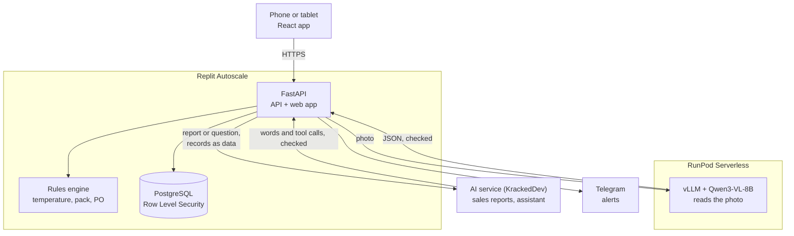

<p align="center">
  
</p>

<h1 align="center">📦 SOPBox</h1>

<p align="center"><b>AI reads. Rules decide. Humans approve.</b></p>

<p align="center">
  <a href="https://github.com/Dellrall/SOPBox/actions/workflows/backend-tests.yml"></a>
  <a href="https://github.com/Dellrall/SOPBox/actions/workflows/ui-tests.yml"></a>
  <a href="https://sopbox.replit.app"></a>
  <a href="LICENSE"></a>
</p>

> **SOPBox** is a phone-first receiving-control platform for small food and beverage outlets. A vision-language model on a serverless GPU reads every supplier delivery order, a deterministic rules engine decides pass or fail, and a human-in-the-loop approval flow puts a manager in charge of every exception. From there it follows the stock to the shelf: expiry lots, counts, sales, orders and reports, with an AI assistant that only suggests, a full audit trail, and multi-tenant isolation enforced down to the database.

---
## 👥 Team Information

| Field                  | Details                                     |
| ---------------------- | ------------------------------------------- |
| **Team Name**          |"Hack into Google, No Mistake"                                      |
| **Team Domain**        | Domain 2                                    |
| **SDG Track (1–17)**   | SDG 12 — Responsible Consumption and Production (target 12.3, food waste); also supports SDG 8 |
| **Team Leader**        | Lye Wei Lun                                      |
| **University**         | Tunku Abdul Rahman University of Management and Technology                                       |
| **Number of Members**  | 5                                           |

## 🔗 Links

| Resource          | Link                                           |
| ----------------- | ---------------------------------------------- |
| GitHub Repository | https://github.com/Dellrall/SOPBox          |
| Live Demo         | https://sopbox.replit.app                      |
| RunPod Endpoint   | https://api.runpod.ai/v2/sriet0cftztbik        |
| Slide Deck        |https://docs.google.com/presentation/d/1bgZOBKZ0It3YUjl5_K89h_N3jCciHSCj/edit?usp=sharing&ouid=116348766400869509017&rtpof=true&sd=true|
| Demo Video        |https://youtu.be/GBqBOp9_C9w                                       |
| How we meet the judging criteria | [docs/JUDGING.md](docs/JUDGING.md) |
---

## 🧭 Overview

### 🔥 Problem

Small F&B outlets lose stock and money when deliveries arrive. Frozen and chilled goods are accepted outside their safe temperature, pack quantities are miscounted (250 pcs per bundle, 12 packets per box) so stock and orders drift apart, and new staff don't know the receiving steps. Nothing is recorded, so the same mistakes repeat and spoiled food is thrown away later.

### 💡 Solution

SOPBox turns receiving into one guided check on a phone. Staff photograph the delivery order and an open-weight vision model on a RunPod GPU reads every line; anything unclear is flagged, never guessed. Staff confirm the lines and enter the probe temperature. Rules in code (not the AI) check temperature, pack conversion and the quantity still due on the purchase order. Any failed line holds the delivery until a manager accepts, rejects or returns it, and every step is logged. **AI reads. Rules decide. Humans approve.**

### ✨ Key Features

- **Receiving check** — photograph the delivery order; the AI fills in the lines for staff to confirm.
- **Rules and approvals** — temperature, pack, expiry and order checks in code; failed lines wait for a manager, who can keep the good lines and send the rest back.
- **Expiry lots** — each batch gets a lot label; earliest expiry used first, alerts before it expires, disposals recorded.
- **Stock, sales and orders** — counts that explain gaps; a sales sheet laid out like the count sheet that records the lot used, or any till report read by AI; orders drafted from low stock.
- **Reports and paper copies** — reports by period, product, supplier or storage area; a PDF of every order, delivery, count, transfer, sale and disposal.
- **Assistant** — ask in English or Malay; it answers from your records through fixed tools, opens the right page, and only suggests actions that run when you tap.
- **Products, SOPs and tasks** — SOP cards per product, daily checklists, and jobs with a person in charge.
- **Built for phones** — tested on small phones and tablets; barcode scanning and kitchen tablet sign-in.

All features: [docs/FEATURES.md](docs/FEATURES.md).

### 💰 Pricing

Launch prices for early customers, held for their first 12 months (list price after that in brackets). Shown live at [sopbox.replit.app/pricing](https://sopbox.replit.app/pricing); the numbers live at the top of `src/backend/app/plans.py`.

| Plan | Price | Includes |
| ---- | ----- | -------- |
| **Free** | RM0 | One outlet (any number of storage areas), up to 50 products, the whole team, 30 AI uses a month (10 of them for sales reading) |
| **Pro** | RM49 a month for the first outlet (RM89) + RM29 for each further outlet (RM49), paid yearly | Charged by use: a month with no work recorded costs nothing. More outlets, HQ branch links, till API keys, 150 AI uses a month per outlet |
| **Pro lifetime** | RM2,990 once per outlet, approved by the team | Then only AI reading is charged, RM0.30 a read |
| **Enterprise** | By quote | Everything, terms agreed with us |
| Add-ons | Priority support RM190 a year (free in the first year); custom work quoted per task, from RM100 | |

One AI use costs us roughly RM0.10–0.30, so each allowance stays well within what the plan brings in. Payments are not taken in the app yet: plans are turned on by the team or with a plan code.

### 🛠️ Tech Stack

| Layer         | Technology                   |
| ------------- | ---------------------------- |
| Frontend      | React 18, TypeScript, Vite, Tailwind CSS, built on the Orbyte template |
| Backend       | Python, FastAPI              |
| Database      | PostgreSQL (Replit), with Row Level Security per workspace |
| AI / Compute  | RunPod Serverless (GPU), vLLM, Qwen3-VL-8B-Instruct (FP8) for delivery orders and SOPs; an OpenAI-compatible service (KrackedDev) for sales reports and the assistant |
| Notifications | Telegram Bot API             |
| Hosting / Dev | Replit (Deployments, Secrets, PostgreSQL) |

---

## 🗂️ Project Structure

```
.
├── src/
│   ├── backend/app/   # FastAPI app
│   └── frontend/
│       ├── src/       # React pages
│       └── e2e/       # Playwright UI tests
├── tests/             # pytest suite
├── runpod/            # AI endpoint settings
├── docs/              # Setup, API, impact
├── submission/        # Submission PDFs
├── .github/workflows/ # Tests on each PR
├── .replit            # Replit run and deploy
├── AGENTS.md          # Notes for AI agents
└── README.md
```

### 🏗️ Architecture



Every model reply is treated as untrusted input: parsed, validated, and confirmed by a person before anything is saved. The pass/fail verdict comes from the rules engine, never from a model. The assistant can only call fixed read-only tools with the asker's own access; its actions are buttons the person taps, which go through the same checked routes as the app. Every AI use counts against the plan's monthly allowance.

---

## 🚀 How to Run

### Option 1 — Run on Replit (Recommended)

1. Import this repository via **Create Repl → Import from GitHub** (`Dellrall/SOPBox`).
2. Create a PostgreSQL database (**Tools → Database**). Replit sets `DATABASE_URL`.
3. Open the **Secrets** tab (🔒) and add the variables in `src/backend/.env.example`:
   - `RUNPOD_API_KEY`, `RUNPOD_ENDPOINT_ID` — photo reading and the SOP writer
   - `AI_API_KEY` — optional, for reading sales reports and the assistant (`AI_BASE_URL`, `AI_MODEL` optional)
   - `MFA_ENCRYPTION_KEY` — keeps authenticator two-step sign-in secrets encrypted
   - `TELEGRAM_BOT_TOKEN` — optional, for alerts and Telegram sign-in
   - `GOOGLE_CLIENT_ID`, `GOOGLE_CLIENT_SECRET` — optional, for Google sign-in
4. Click **Run**. The `.replit` file builds the frontend and starts the app on port 8000. Tables are created or updated at start-up (`python -m app.migrate` does it on its own).
5. Open the app and choose **Create a workspace**. You become its owner.

Without the RunPod secrets, everything works except photo reading: staff type the lines by hand. Without `AI_API_KEY`, sales lines are matched by hand and the assistant gives its fixed answers.

### Option 2 — Run Locally

Needs Python 3.11+ and Node 20+. An embedded PostgreSQL is included, so nothing else to install.

```bash
# 1. Clone the repository
git clone https://github.com/Dellrall/SOPBox.git
cd SOPBox

# 2. Backend: virtual environment and dependencies
cd src/backend
python -m venv .venv
source .venv/bin/activate        # Windows: .venv\Scripts\activate
pip install -r requirements-dev.txt

# 3. Start a local database; it prints DATABASE_URL to export in the next terminal
python -m app.devdb

# 4. In a second terminal: run the backend on http://localhost:8000
cd src/backend && source .venv/bin/activate
export DATABASE_URL=...  COOKIE_SECURE=0    # the lines printed in step 3
uvicorn app.main:app --port 8000

# 5. In a third terminal: run the frontend on http://localhost:5173
cd src/frontend && npm install && npm run dev
```

### Option 3 — Set up with an AI coding agent

```bash
# 1. Clone the repository
git clone https://github.com/Dellrall/SOPBox.git
cd SOPBox

# 2. Open it in your coding agent (pick one)
claude          # Claude Code
codex           # Codex CLI
cursor .        # Cursor

# 3. Ask the agent:
#    "Read AGENTS.md and set up SOPBox locally, then start it."
```

[AGENTS.md](AGENTS.md) gives the agent the setup commands, project structure, rules (AI writes words, code does the maths; workspace isolation), contribution and customization steps, and where the API is documented.

### 🧪 Run Tests

```bash
python -m pytest                       # 418 backend tests, from the repository root (runs in CI)

cd src/frontend && npm ci && npx playwright install chromium
npm run test:ui                        # 98 UI test runs on small phones and tablets
```

---

## 🟠 How We Use Replit *(Required)*

- **Development:** the team imports this GitHub repository into a shared Repl and runs it with **Run**.
- **Hosting:** the app is published with **Replit Deployments (Autoscale)** at https://sopbox.replit.app. One FastAPI process serves the built React app and the API.
- **Database:** **Replit PostgreSQL** stores every workspace's data. Row Level Security keeps each business's data separate inside the database.
- **Secrets:** the RunPod, AI service, Telegram and Google keys are kept in **Replit Secrets**, never in the code.

📄 Proof of use: [`submission/SDC2026_Hack into Google, No Mistake_Replit_POU.pdf`](submission/SDC2026_Hack%20into%20Google%2C%20No%20Mistake_Replit_POU.pdf)

## 🟣 How We Use RunPod *(Required)*

- **Workload:** the core AI runs on a RunPod GPU: reading delivery-order photos, reading supplier sheets, writing and checking SOPs, explaining count gaps and the Telegram bot's plain sentences. (Sales reports and the assistant use a second, OpenAI-compatible service.)
- **Setup:** a **RunPod Serverless endpoint** (`sriet0cftztbik`) runs RunPod's official vLLM worker with **Qwen3-VL-8B-Instruct (FP8)** on a 24 GB GPU. It scales to zero, so it costs nothing when idle. Settings are in [`runpod/README.md`](runpod/README.md).
- **Integration:** the Replit app sends jobs with `RUNPOD_API_KEY` and `RUNPOD_ENDPOINT_ID` (`/run`, then polls `/status`), treats the reply as untrusted input, validates it, and has staff confirm every line. An hourly cap bounds GPU spend.

Example request (OpenAI-style chat through the vLLM worker):

```bash
curl -X POST https://api.runpod.ai/v2/$RUNPOD_ENDPOINT_ID/runsync \
  -H "Authorization: Bearer $RUNPOD_API_KEY" \
  -H "Content-Type: application/json" \
  -d '{"input": {"openai_route": "/v1/chat/completions",
       "openai_input": {"model": "sopbox-reader", "temperature": 0,
         "messages": [{"role": "user", "content": "Write 3 steps for receiving frozen chicken."}]}}}'
```

📄 Proof of use: [`submission/SDC2026_Hack into Google, No Mistake_Runpod_POU.pdf`](submission/SDC2026_Hack%20into%20Google%2C%20No%20Mistake_Runpod_POU.pdf)

---

## 🧗 Challenges & Learnings

- **AI that guesses is dangerous.** Delivery orders have crossed-out, smudged and handwritten quantities, and a wrong guess means wrong stock. We ask the model to leave unclear values blank and flag them, keep the pass/fail decision in code, and have staff confirm every line.
- **A small model as a checker.** An open "list the problems" prompt for the SOP checker invented problems and sometimes ran on forever. Asking for a yes/no verdict on each step fixed it.
- **GPU cost and cold starts.** With a US$25 budget we chose serverless, scaled to zero, and FP8 weights on a 24 GB GPU. The trade-off is a 2–3 minute wait on the first photo after idle, so staff can always type lines by hand. Some GPU types were throttled mid-load and are now excluded.
- **Keeping businesses' data apart.** Filtering in code wasn't enough on its own, so PostgreSQL Row Level Security enforces it in the database as well, and tests check it directly.
- **Publishing safely.** Replit's Publish once proposed dropping production tables because the development database was behind. We learned to update development first and never accept a `DROP`.
- **Phones first.** Automated phone-size tests caught layout bugs (pages scrolling sideways, the inbox opening behind the page) that desktop testing missed.

## 🔭 Future Improvements

We build these one phase at a time; each phase is its own pull request.

| Phase | Improvement | Status |
|---|---|---|
| 1 | Barcode scanning to pick products when receiving and ordering | ✅ Done |
| 2 | Daily task lists per role and event-based SOPs (peak hour, new starter) | ✅ Done |
| 3 | Demand forecasting from sales history, feeding purchase order suggestions | ✅ Done |
| 4 | Payments inside the app (upgrades are requests today) | Needs a payment provider |
| 5 | Light LoRA fine-tune on synthetic delivery orders, behind the same endpoint name | Needs GPU budget |
| — | Telegram fixes: bot replies, PIC commands with @tags, tags and PIC changes sent on Telegram | ✅ Done |
| — | Expiry lots, sales sheet with the lot used, sales read from any till report, reports, monthly AI allowance | ✅ Done |
| — | Assistant with function calling (read-only tools, tap-to-run actions, prompt-injection guards) and a PDF of every record | ✅ Done |
| 6 | More assistant actions, each one a tap on a checked route (plan a count, start a transfer) | Planned |

## 🤝 Team

| Name        | Role                | GitHub                                   |
| ----------- | ------------------- | ---------------------------------------- |
| Lye Wei Lun| Team Lead|https://github.com/Dellrall|
| Leong Zoe Yee| Backend |https://github.com/LEONGZOEYEE|
| Ng Sze ya| Frontend|https://github.com/NgSzeYa|
| Puteri A'ina Auji Farzana | AI / RunPod|https://github.com/TheTN-G|
| Siow Wei Yik|Design & QA|https://github.com/Weiyik88|

### 📚 Third-party code, models and assets

- **Open source:** FastAPI, Uvicorn, Pydantic, httpx, psycopg, openpyxl, py_webauthn, React, Vite, TypeScript, Tailwind CSS, Lucide icons, SimpleWebAuthn, Plus Jakarta Sans (Fontsource), pytest, Playwright, vLLM (RunPod worker-v1-vllm).
- **Pre-trained model:** Qwen3-VL-8B-Instruct by the Qwen team (Apache 2.0), used as released.
- **Images:** dashboard kitchen photo by Yanhao Fang on Unsplash; SDG icons © United Nations.

---

## ✅ Submission Checklist

- [x] Team name, domain (Domain 1 / Domain 2) and SDG track filled in
- [x] Slide deck link added
- [x] Demo video link added
- [x] Replit used, with proof of use in `submission/`
- [x] RunPod used, with proof of use in `submission/`
- [x] Preliminary submission completed (`SDC2026_Hack into Google, No Mistake_Preliminary.pdf`)
- [x] Technology declaration completed (`SDC2026_Hack into Google, No Mistake_TechDeclaration.pdf`)
- [x] Submission files renamed with your team name (replace `TeamName`)
- [x] "How to Run" steps verified
- [x] No API keys or secrets committed to the repository

## 📄 License

This project is licensed under the [Apache License 2.0](LICENSE).
